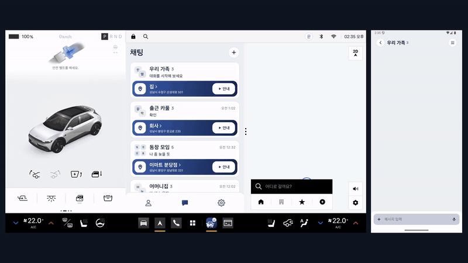

# TokCar — 운전 중에도 가족과 대화하고 경로를 나누는 Pleos 차량용 앱

가족 단톡방에서 온 메시지를 차 안에서 보고, 방마다 정해 둔 목적지로 **한 번에 길안내를 시작**하면서 **가족에게 도착 예상 정보를 실시간으로 공유**하는 Pleos Connect 차량용 앱입니다.
가족은 폰 앱에서 차의 위치 · 남은 시간 · 막히는 구간을 지도로 봅니다. 도착하면 공유는 자동으로 끝납니다.

## 시연 영상

[](docs/demo/tokcar_demo.mp4)

**[▶ 데모 영상 보기 (80초, 소리 포함)](docs/demo/tokcar_demo.mp4)** — 왼쪽이 차량 앱(Pleos Connect 에뮬레이터), 오른쪽이 가족 폰 앱입니다. 서버를 켠 상태에서 녹화했습니다.

**[▶ 홍보용 쇼츠 (YouTube)](https://youtube.com/shorts/IoLM8zKRTpA)**

## 이 저장소에 있는 것

| 폴더 | 내용 |
|---|---|
| `tokcar/` | **차량용 앱** (Kotlin · Jetpack Compose). 공모전 제출 대상 |
| `phone-app/` | 가족용 **폰 앱** (Flutter). 차량 앱과 같은 화면 · 메시지, 경로 공유는 지도로 보기 |
| `server/` | 두 앱이 같이 쓰는 **가족 서버** (Java 21 · Spring Boot · 순수 WebSocket). **앱은 이 서버가 있어야 동작** |
| `apk/` | 실행 가능한 release APK (`tokcar_TokCar_release.apk`, 서버가 켜져 있어야 로그인됨) |
| `start_demo.sh` | 차량 앱 설치 · 실행 + 서버 시작을 한 번에 (Linux · macOS) |

## 주요 기능

- **가족 대화**: 방마다 대화 · 현재 위치 · 경로 공유 카드. 안 읽은 사람 수 표시, 새 메시지는 음성으로 읽어 줌.
- **방마다 최근 목적지**: 방 목록 카드의 `[안내]` 한 번이면 그 방의 최근 목적지로 길안내를 시작(실제 Pleos 내비에 경로 요청).
- **15초 공유 대기**: 안내를 시작해도 공유는 바로 시작되지 않고 15초 동안 취소할 수 있음(운전 중 실수 방지).
- **실시간 경로 공유**: 가족에게 출발 · 도착 주소, 남은 시간 · 도착 예정 시각, 정체 구간(막대)이 계속 갱신됨. 도착하면 카드가 「도착」으로 바뀌고 공유가 끝남.
- **경유지 · 목적지 변경**: 안내 중 경유지를 넣어도 공유가 끊기지 않음. 내비에서 직접 목적지를 바꿔도 앱이 따라감.
- **가족 폰 앱**: 위치 보내기는 핀을 옮겨 고르는 화면(장소 검색 포함). 경로 공유 카드의 `[지도 보기]`로 차가 움직이는 모습을 봄.

## 테스트 환경

| 항목 | 값 |
|---|---|
| 에뮬레이터 | **Pleos Connect v2.1.0** (AVD 이름 `Pleos_Connect_v2.1.0`, 에뮬레이터 37.2.13.0) |
| Android | 14 (API 34) |
| 화면 | **2560 × 1440** |
| 설치 사용자 | `10` (Pleos 에뮬레이터는 화면이 사용자 10으로 돌아서 `adb install`에 `--user 10`을 붙입니다) |
| Pleos SDK | Vehicle 2.3.2 · NaviHelper 3.0.5 · FusedLocation 1.1.3 · SpeechToText 3.3.1 · TextToSpeech 3.3.1 |
| 빌드 | Android Gradle Plugin 9.4.1 · Gradle 9.6.0 · Kotlin 2.2.10 · JDK 21 · compileSdk 37 · minSdk 28 |
| 폰 앱 | Flutter 3.44.8 (Android 폰 에뮬레이터 API 36에서 확인) |
| 서버 | Java 21 · Spring Boot 4.1 · H2(로컬) / PostgreSQL(AWS) |

차량 앱의 `applicationId`와 코드 패키지는 모두 `com.example.tokcar`입니다.

## 서버가 필요합니다 (더미 모드 없음)

차량 앱과 폰 앱은 **가족 서버(`server/`)에 연결돼야 동작**합니다(서버가 꺼져 있으면 로그인할 수 없음). 앱은 기본으로 `http://10.0.2.2:8080`을 봅니다. 에뮬레이터의 `10.0.2.2`는 에뮬레이터를 돌리는 PC이므로, **같은 PC에서 서버를 켜면** 따로 설정할 것이 없습니다.

## 실행 방법 1: 한 번에 (Linux · macOS)

Pleos Connect 에뮬레이터(v2.1.0)를 켜 둔 상태에서:

```bash
./start_demo.sh
```

차량 앱을 빌드해 에뮬레이터에 설치 · 실행하고, 가족 서버를 이 터미널에서 시작합니다(끄려면 Ctrl+C). 필요: Java 21, Android SDK(`ANDROID_HOME`, 기본 `~/Android/Sdk`). 에뮬레이터가 둘 이상 켜져 있으면 `adb devices`로 Pleos 에뮬레이터의 기기 ID(예: `emulator-5554` 모양, 켠 순서에 따라 달라짐)를 확인하고 `ADB_SERIAL=<기기ID> ./start_demo.sh`로 지정합니다.

- 차 앱 로그인: 아이디 `papa` · 비밀번호 `papa1234!`
- 폰 앱(선택): `cd phone-app && flutter run -d <폰 에뮬레이터> --dart-define-from-file=env.json` (`env.json`은 `env.example.json` 참고) → 아이디 `minji` · 비밀번호 `minji1234!`.

## 실행 방법 2: 직접 (Windows 포함)

1. 서버: `cd server` 후 `./gradlew bootRun` (Windows는 `.\gradlew.bat bootRun`) → `http://localhost:8080`. 가계정은 `papa`(차량 앱) · `minji`(폰 앱), 비밀번호는 `server/src/main/resources/application-local.properties`(시험용). 방 `우리 가족` 외에 가짜 친구 · 방이 함께 만들어짐.
2. 차량 앱 (Linux · macOS):

```bash
cp local.properties.example local.properties     # sdk.dir 에 Android SDK 경로만 적음(Android Studio 로 열면 자동으로 만들어져 이 줄은 필요 없음)
./gradlew :tokcar:assembleDebug
adb install -r --user 10 tokcar/build/outputs/apk/debug/tokcar-debug.apk
adb shell am start --user 10 -n com.example.tokcar/.TokCarActivity
```

   Windows (PowerShell):

```powershell
Copy-Item local.properties.example local.properties
.\gradlew.bat :tokcar:assembleDebug
adb install -r --user 10 tokcar\build\outputs\apk\debug\tokcar-debug.apk
adb shell am start --user 10 -n com.example.tokcar/.TokCarActivity
```

   미리 빌드한 APK(`apk/tokcar_TokCar_release.apk`, release · 서명됨)를 쓰려면 `tokcar/build/...` 자리에 그 경로를 넣어 같은 명령으로 설치합니다. 서버 주소가 `10.0.2.2:8080`이 아니면 `local.properties`의 `tokcar.server`로 정해 다시 빌드합니다.
3. 폰 앱: `cd phone-app && flutter run -d <기기ID> --dart-define-from-file=env.json` (서버 주소를 바꾸려면 `--dart-define=TOKCAR_SERVER=...`. 실제 폰은 `adb reverse tcp:8080 tcp:8080` 후 `http://localhost:8080`).
4. 시연 순서: 폰(민지)에서 메시지 보내기 → 차 앱에서 `[안내]` → 15초 뒤 폰에 경로 공유 카드 → `[지도 보기]`.

`adb`는 Android SDK의 `platform-tools` 폴더에 있고 Windows · macOS · Linux에서 명령이 같습니다(`adb`가 PATH에 없으면 전체 경로로 실행). 에뮬레이터가 둘 이상 켜져 있으면 `adb devices`로 기기 ID를 확인해 `adb -s <기기ID> ...`처럼 지정합니다. 네이버 키가 없어도 서버와 앱은 뜹니다(주소 변환 · 경로 · 장소 검색만 꺼짐, 아래 「네이버 키」).

## 개발용 설정 (에뮬레이터에서 시연하기 위한 것)

설정 탭 맨 아래 「개발용 · 시험」에 있습니다. **처음 설치하면 「실제 내비 쓰기」와 「내비 연결 + 데모 이동값」이 켜져 있어서**, [안내]를 누르면 실제 Pleos 내비에 경로가 뜨고 남은 시간은 데모 이동값으로 줄어듭니다(Pleos 내비에 못 붙으면 앱 안의 데모 GPS로 자동으로 바뀝니다).

- **실제 내비 쓰기**: 켜면 Pleos 내비에 실제로 경로를 요청합니다. 꺼두면 앱 안의 데모 이동값으로 돕니다.
- **내비 연결 + 데모 이동값**(기본 켜짐): 에뮬레이터의 내비는 차가 움직이지 않아 남은 시간이 줄지 않으므로, 내비는 실제로 연결하되 남은 시간 · 위치는 움직이는 데모 값으로 대신합니다. **실차에서는 끄세요.**
- **우리 가족 데이터 정리**: 서버를 쓸 때 시연 전에 방을 처음 상태로 되돌립니다.

## 네이버 키 (서버에만 둠)

네이버 지도 API의 **Client Secret은 차량 앱 · 폰 앱 · 저장소 어디에도 없습니다.** 주소 변환(Reverse Geocoding) · 주소 검색(Geocoding) · 경로(Directions 5) · 장소 검색(API HUB 지역 검색)은 앱이 가족 서버(`/api/naver/*`)에 로그인 토큰으로 요청하면 **서버가 키를 붙여 대신 네이버를 부릅니다.** APK를 풀어도 꺼낼 키가 없습니다.

서버에 키를 주는 방법(둘 중 하나, 올리지 않는 파일/환경 변수):

```bash
cd server
cp secrets.properties.example secrets.properties   # naver.maps.client-id/secret, naver.search.client-id/secret 을 채움
# 또는 환경 변수: NAVER_MAP_CLIENT_ID, NAVER_MAP_CLIENT_SECRET, NAVER_SEARCH_ID, NAVER_SEARCH_SECRET
```

서버에 키를 주지 않으면 다음처럼 동작합니다.

- 차량 앱: 내비 좌표를 도로명 주소로 바꾸는 기능이 꺼지고, Pleos 내비가 주는 「수정구 시흥동」 같은 동 주소를 그대로 씁니다.
- 폰 앱: 지도 SDK용 Client ID(`phone-app/env.example.json`을 `env.json`으로 복사)가 없으면 그림 지도로 보이고, 서버에 키가 없으면 주소 · 경로 · 장소 검색은 되지 않습니다.
- 서버는 사용자당 분당 120회로 호출을 제한하고, 네이버 응답을 저장하지 않고 그대로 전달만 합니다(약관상 결과 저장 · 재사용 금지).

## 테스트

```bash
./gradlew :tokcar:testDebugUnitTest      # 차량 앱
cd server && ./gradlew test              # 서버 (실제 WebSocket 으로 붙는 흐름 포함)
cd phone-app && flutter test             # 폰 앱
```

Windows에서는 `./gradlew` 대신 `.\gradlew.bat`을 씁니다(폰 앱의 `flutter` 명령은 같음).

## 알려진 한계

- 에뮬레이터의 Pleos 내비는 차 위치가 고정(42dot)이라 안내를 시작해도 남은 시간이 줄지 않습니다 → 위의 「내비 연결 + 데모 이동값」으로 시연합니다. 실차에서는 내비가 주는 값을 그대로 씁니다.
- 앱이 보낸 안내 취소 요청에 에뮬레이터 내비가 반응하지 않는 경우가 있어, 시연에서는 도착 뒤 내비의 「안내 종료」를 직접 누릅니다.
- 가입 · 친구 추가는 아직 「다음 단계」 안내만 뜹니다(가계정으로 로그인).
- 서버의 로그인 토큰은 메모리에만 있어서 서버를 다시 켜면 다시 로그인해야 합니다(AWS 배포 단계에서 Redis로 옮길 계획).

## 외부 서비스 · 데이터

- Pleos SDK: `https://nexus-playground.pleos.ai/repository/maven-releases/`에서 받습니다.
- 네이버 Maps(Reverse Geocoding · Geocoding · Directions 5 · 지도) · NAVER API HUB(지역 검색)는 약관에 따라 서버를 거쳐 사용했고, 응답 결과를 저장소나 서버에 저장하거나 다시 배포하지 않습니다.

## 폴더 구조

```
tokcar/           차량 앱 모듈 (src/main/java/com/example/tokcar: core · ui · navi · remote · vehicle · data)
phone-app/        폰 앱 (lib/: core · data · ui · config, test/)
server/           가족 서버 (src/main/java/com/example/tokcar/server, docs/api.html · docs/erd.html)
apk/              release APK
```
